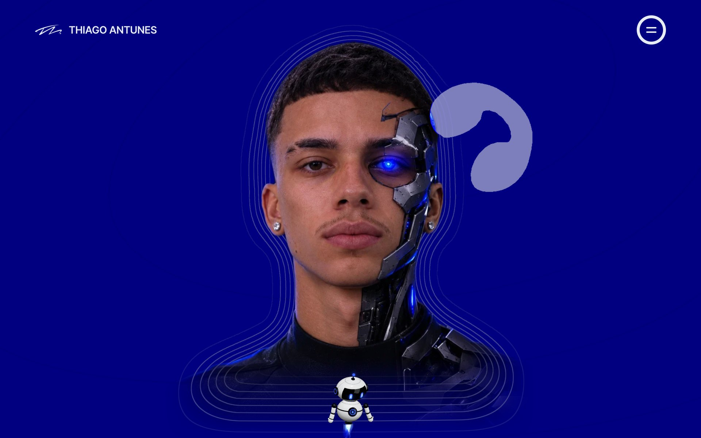
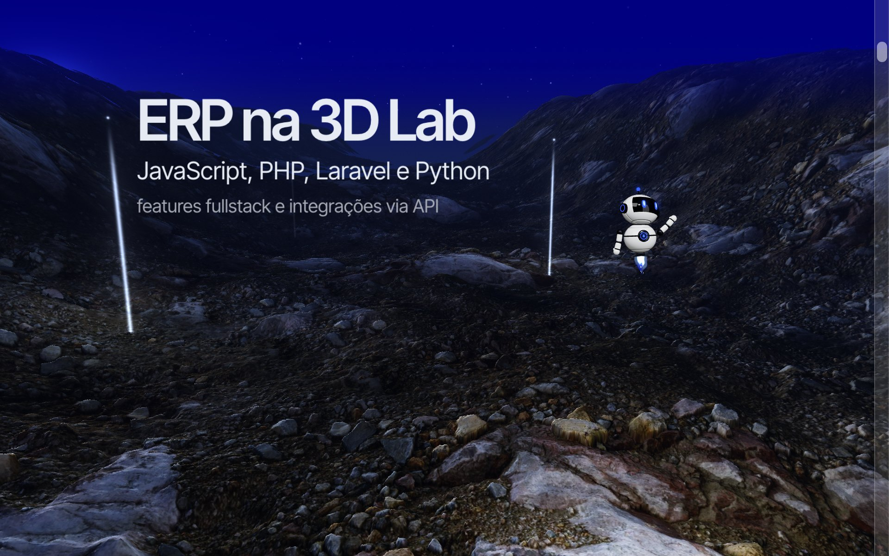
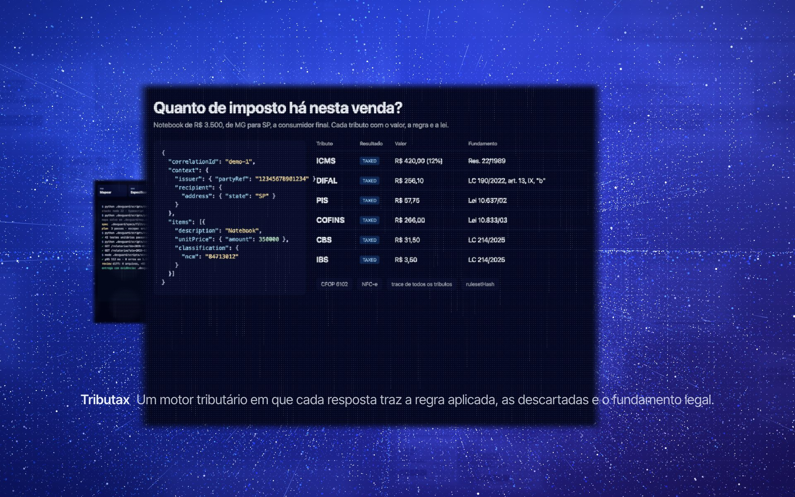
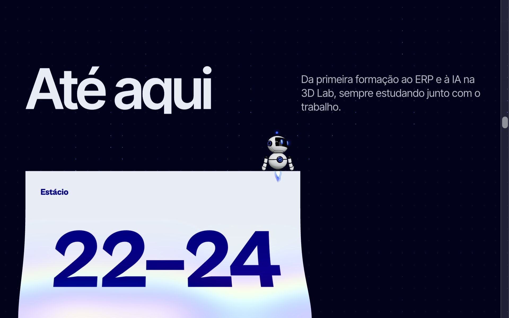
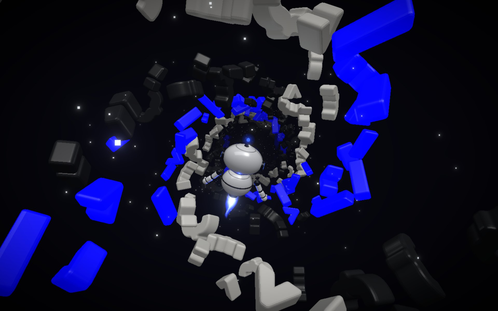
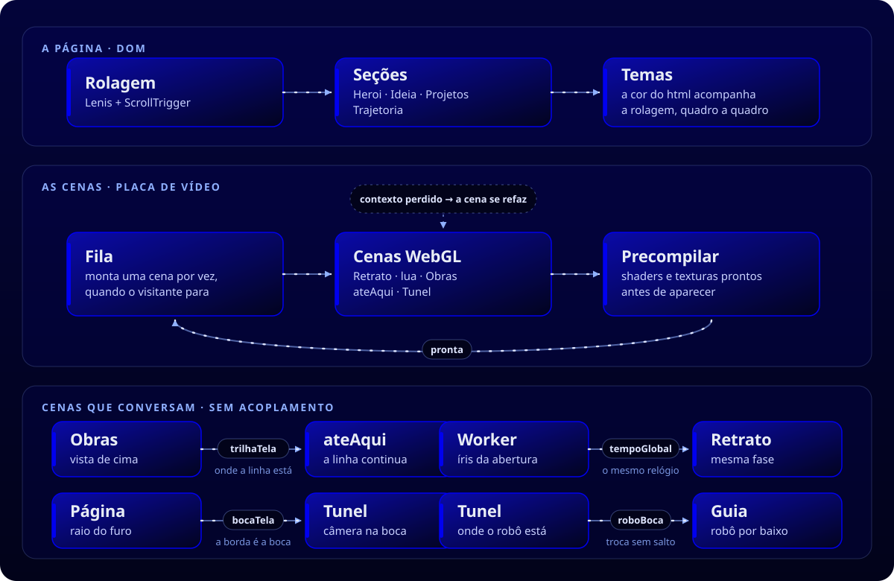

<div align="center">

<a href="https://thiagoantunes.com/"></a>

</div>

<br>

Este é o portfólio de **Thiago Antunes**, engenheiro de software na 3D Lab, em Belo Horizonte. Não é uma página com seções empilhadas. É **um passeio só**, contado pela rolagem: começa num retrato meio humano, meio robô, desce por um vale lunar onde cada camada da stack é um farol aceso, sobe para o céu onde os projetos flutuam, olha para trás o caminho percorrido e mergulha num túnel até o contato.

O site defende uma ideia: **sistemas que se explicam**. É a mesma regra dos projetos: o Tributax devolve cada cálculo com a regra aplicada e o fundamento legal, a MNEME não aceita estratégia sem prova em dados que nunca viu, e o DevGuard só deixa um agente de IA entregar com evidência. Por isso cada parte do site mostra o próprio mecanismo: nada de vídeo pronto, tudo é desenhado ao vivo e reage à rolagem e ao cursor.

## A ideia

**Uma câmera, um mundo, uma linha de luz.** Cada seção nasce do que a anterior deixou na tela. Não há corte reto entre partes nem fade de "apagar a luz":

- o azul do topo vira o céu do vale;
- a câmera do vale ergue os olhos e os projetos já estão lá em cima;
- os riscos de velocidade se dissolvem nas partículas da matriz;
- no fim dos projetos, a câmera vira e olha o caminho que percorreu, e esse caminho, visto de cima, vira a trilha que guia pela trajetória;
- a trilha termina no centro da tela, onde o túnel abre.

**O conteúdo é real.** As camadas do vale, os projetos e as datas da trajetória vêm do README do perfil e dos repositórios.

**O robô é o guia.** Um robô modelado no código, sem arquivo 3D pronto, acompanha a leitura: senta nos títulos, acena nos faróis, voa em arco de um cartão para o outro e é ele quem entra no túnel.

## O passeio

<p align="center"></p>

**Retrato.** O topo é só o retrato, sem texto. Onde o cursor passa, uma tinta líquida simulada na placa de vídeo revela o robô por baixo do rosto, e curvas de nível giram em volta. Antes dele, uma abertura dá um close no olho robótico: a íris mecânica é desenhada num shader, num Worker com `OffscreenCanvas`, e o anel de calibração segue o carregamento real das cenas.

<table>
<tr>
<td width="50%" valign="top">


**Vale lunar.** Um terreno em raymarch (WebGL 2 puro) iluminado pela lua, com estrelas e o cursor como lanterna. Cada farol é uma camada de como o Thiago constrói: ERP, back-end, dados, IA e agentes, front-end e entrega. A stack e a regra de arquitetura ficam presas ao alto de cada coluna de luz.
</td>
<td width="50%" valign="top">


**Projetos.** Um mundo em profundidade, com capas em matriz de pontos, parede de imagens azuladas e chuva de pontos. A câmera para diante de cada capa. Clicar abre o projeto em cúpula, com a explicação tirada do README, a stack e o link.
</td>
</tr>
<tr>
<td width="50%" valign="top">


**Até aqui.** A linha de luz da vista de cima continua e passa por cada cartão da trajetória: Estácio, Engenharia de Software, estágio e cargo de júnior na 3D Lab. Os cartões são desenhados em WebGL: esticam com a velocidade da rolagem, abrem em sino no pé da tela e ganham um brilho furta-cor.
</td>
<td width="50%" valign="top">


**Túnel e contato.** O robô mergulha num túnel em cinco trechos: costelas que acendem quando ele passa, uma parede de símbolos de código, uma sala aberta, portais que giram e um trecho em velocidade. A saída é luz branca, e ali estão o e-mail e os perfis.
</td>
</tr>
</table>

## Stack

| Camada | O quê | Para quê |
|---|---|---|
| Base | **Next.js 16**, **React 19**, **TypeScript** | páginas geradas no build e servidas pela Vercel; só o contador de visitas roda no servidor |
| 3D | **three.js 0.186**, **React Three Fiber 9**, **drei**, **postprocessing** | o mundo dos projetos, o túnel, o robô e o retrato |
| Shaders | **GLSL** escrito à mão e **WebGL 2 puro** | o vale em raymarch, os cartões do "Até aqui", a íris da abertura, o fluido do retrato |
| Movimento | **GSAP 3** com **ScrollTrigger**, **Lenis** | a rolagem suave e tudo o que anda preso a ela |
| Fora da thread principal | **Web Worker** + **OffscreenCanvas** | a abertura continua a 60 quadros enquanto a página monta |
| Tipografia | **Cabinet Grotesk** (400, 500, 800) | a mesma fonte no site e no banner deste README |
| Ferramentas | **ESLint**, **Playwright** | lint e a conferência visual de cada mudança, rolando o site de verdade |
| Publicação | **Vercel** (repositório conectado) | cada push na `main` vira o site no ar em thiagoantunes.com |

| Cor | Hex | Uso |
|---|---|---|
| Deep Blue | `#000080` | áreas grandes: o topo, o céu do vale, o projeto aberto |
| Azul vivo | `#0000F0` | blocos dos títulos e botões; onde o Deep Blue some sobre o escuro |
| Black | `#050505` | fundo |
| Ice White | `#E8EDF5` | texto principal, a trilha de luz |
| Cool Gray | `#A5A9B4` | texto secundário |

## Arquitetura

```
src/
├── app/                              layout, página, tokens de design, fontes, robots e sitemap
├── site/                             as seções (DOM) e quem rege a página
│   ├── Heroi, Ideia, Projetos,       as seções, na ordem do passeio
│   │   Trajetoria, Contato
│   ├── Abertura + aberturaMotor      a íris de carregamento,
│   │   + abertura.worker             desenhada num Worker
│   ├── Rolagem, Temas,               rolagem suave, cor da página,
│   │   Cabecalho, GuiaRobo           menu e robô guia
│   └── fila, tempoGlobal, projecao   montagem das cenas, relógio comum, recorte 3D
├── cena/                             tudo o que é desenhado na placa de vídeo
│   ├── Retrato + fluido              retrato do topo e o fluido que revela o robô
│   ├── lua                           o vale lunar (WebGL 2 puro, raymarch)
│   ├── Obras                         o mundo dos projetos (R3F)
│   ├── ateAqui + trilhaTela          os cartões e a trilha do "Até aqui"
│   ├── Tunel + portalTunel           o túnel e a boca dele na página
│   ├── RoboAgente + Guia             o robô (modelado no código) e o guia
│   └── Precompilar + contexto        shaders prontos antes da hora, contexto WebGL de volta
└── content/                          perfil, projetos e endereço: o conteúdo, separado de quem o mostra
```

<p align="center"></p>

**Decisões que seguram o desempenho:**

- **Uma cena pesada por vez.** O retrato é a única cena que aparece logo. As outras (vale, projetos, túnel, cartões) entram numa fila e só montam quando o visitante para de mexer, para a compilação de shaders nunca cair no meio de uma animação. Se ele chegar perto de uma cena antes, ela passa na frente (`src/site/fila.ts`).
- **Nada compila na hora de aparecer.** O three.js só compila um material na primeira vez que ele é desenhado, e isso travava a rolagem por até 1 s. Por isso os shaders compilam em paralelo (`KHR_parallel_shader_compile`) e as texturas sobem uma por vez, logo depois de a cena montar (`src/cena/Precompilar.tsx`).
- **A abertura fora da thread principal.** A íris roda num Worker com `OffscreenCanvas`, então continua fluida enquanto o React hidrata e as cenas montam. Um relógio comum (`tempoGlobal`) garante que o último quadro dela e o primeiro do retrato estejam na mesma fase.
- **Contexto WebGL perdido não vira tela branca.** Se o navegador tirar a placa de vídeo do canvas (muitas abas, memória acabando), a cena é refeita do zero quando o contexto volta (`src/cena/contexto.tsx`).
- **Nitidez de verdade.** As cenas desenham na densidade real da tela, até 2x, e os pontos são medidos em pixels do aparelho. O vale só baixa a resolução se cair abaixo de 30 quadros por segundo, e no máximo até 75%.
- **Cenas que conversam sem acoplamento.** Quando uma passagem precisa casar duas cenas, uma escreve num objeto pequeno e a outra lê. É assim que a linha dos projetos vista de cima continua no "Até aqui" no mesmo ponto da tela e com a mesma espessura (`src/cena/trilhaTela.ts`).
- **A cor da página não briga com a rolagem.** O fundo e o texto são calculados a cada quadro pela posição da rolagem, a partir do tema de cada seção (`data-tema`), em vez de vários tweens no mesmo elemento (`src/site/Temas.tsx`).

**Acessibilidade:**

- com movimento reduzido, a rolagem fica nativa e a abertura não aparece;
- há um link para pular direto ao conteúdo;
- os títulos e os projetos têm versão em texto para leitores de tela, com os mesmos links das capas;
- o projeto aberto é um diálogo de verdade: fecha com Esc e devolve o foco ao lugar de onde veio.

## Rodar e publicar

Para rodar no seu computador (Node 22 ou mais novo):

```bash
npm install
```

```bash
npm run dev
```

O site abre em `http://localhost:3000`. Para gerar a versão estática que vai para o ar:

```bash
npm run build
```

```bash
npm start
```

**Publicação.** O repositório está conectado à Vercel: cada push na `main` roda `next build` (ver [`vercel.json`](vercel.json) e [`next.config.ts`](next.config.ts)) e o resultado vai ao ar em [thiagoantunes.com](https://thiagoantunes.com/), na raiz do domínio.

**Contador de visitas.** [`src/app/api/visitas/route.ts`](src/app/api/visitas/route.ts) guarda os números num Redis da Upstash. Na Vercel: em *Storage*, criar um banco **Upstash for Redis** ligado ao projeto (isso cria `KV_REST_API_URL` e `KV_REST_API_TOKEN`); em *Settings → Environment Variables*, criar `VISITAS_SENHA`; depois publicar de novo. Sem essas variáveis o site funciona igual, só não conta. O painel também lista as últimas visitas (cidade aproximada, origem, aparelho, navegador e hora, sem guardar o IP); um link como `thiagoantunes.com/?de=empresa` aparece na lista com essa marca.

O banner animado e o diagrama da arquitetura deste README saem de [`tools/readme-svg.mjs`](tools/readme-svg.mjs) (`node tools/readme-svg.mjs`), com o retrato e a fonte do site embutidos.

<br>

<div align="center">

**[thiagofsprofissional@gmail.com](mailto:thiagofsprofissional@gmail.com)** · [GitHub](https://github.com/th1agx) · [LinkedIn](https://www.linkedin.com/in/thiagofilipeantunes)

<sub>Textura do vale: Rocks Ground 02, do Poly Haven (CC0). Fonte: Cabinet Grotesk, da Indian Type Foundry (Fontshare).</sub>

</div>
